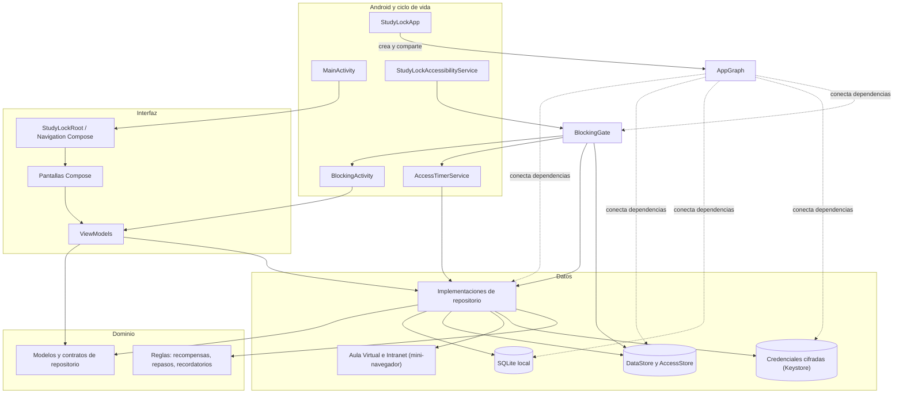
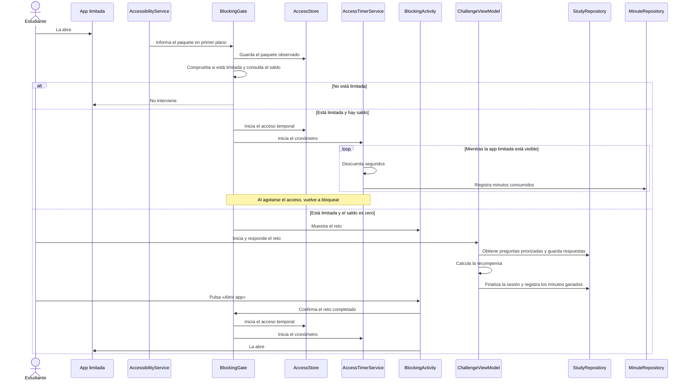
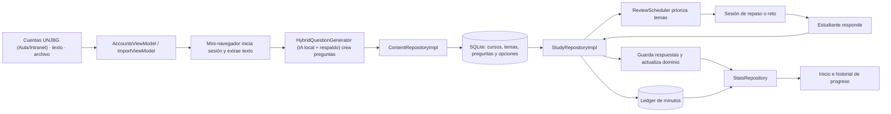

# StudyLock UNJBG

Aplicación Android nativa que convierte el tiempo de ocio en repaso académico. Cuando se
agotan los minutos disponibles, abrir una app limitada (TikTok, Instagram, YouTube, juegos…)
muestra un **reto rápido de 2 preguntas**. Resolverlo otorga minutos de acceso temporales que
se descuentan solo mientras usas esa app.

> Estado: **iteración actual completa y escalable**. Incluye el bucle de bloqueo, generación de
> preguntas a partir de tu propio material (modelo local opcional + respaldo determinista),
> vinculación de **Cuentas UNJBG** (Aula Virtual e Intranet) con un mini-navegador visible,
> sincronización automática diaria, horario con recordatorios e historial de minutos y rachas.
> No hay cursos de demostración: si no se detecta contenido, la app lo dice y muestra los enlaces vistos.

> **¿Solo quieres instalarla en tu celular?** Sigue la guía paso a paso:
> **[docs/INSTALACION.md](docs/INSTALACION.md)** (requisitos, instalación y solución de errores
> como «App no instalada» o «configuración restringida» de accesibilidad en Android 13+).

> **Beta actual: `v0.3.0-beta.2` (APK firmado, `versionCode 4`).** Se instala directamente sobre
> `v0.3.0-beta.1` sin desinstalar y conserva cursos, minutos y preferencias. Esta beta corrige el
> flujo **«Ya tengo cuenta»** (ahora solo pide el correo y no repite permisos, apps ni credenciales)
> y la **sincronización UNJBG**: el mini-navegador ya no se destruye al salir de la pantalla, el
> árbol se ve por partes mientras busca, hay progreso, botón «Ya terminé el ingreso» y Cancelar,
> y los timeouts son más cortos. El servidor con mapa del árbol sigue diferido hasta terminar el MVP.
> El asset del modelo local (`model-gemma3-270m`) aún debe publicarse para que el botón de descarga
> funcione.

---

## 1. Qué incluye esta versión

### Flujo de interrupción positiva
- `AccessibilityService` detecta la app que pasa a primer plano (solo lee el nombre del paquete).
- `BlockingGate` decide: dejar pasar, iniciar acceso o abrir la pantalla de bloqueo.
- `BlockingActivity` muestra el reto de 2 preguntas y el resultado con los minutos ganados.
- `AccessTimerService` (foreground service) hace la cuenta regresiva y consume minutos reales.
- El temporizador **se pausa solo** cuando la app limitada deja de estar visible: el primer plano
  se reconstruye con los eventos `ACTIVITY_RESUMED`/`ACTIVITY_PAUSED` de `UsageStatsManager`
  (fuente principal) y se contrasta con el último paquete observado por accesibilidad. Así no se
  gastan minutos navegando en otra parte y el saldo mostrado coincide con el real.
- Al llegar a cero, se vuelve a bloquear automáticamente.
- **Desbloqueo de emergencia** de 2 minutos con espera de 20 minutos entre usos.
- Estado del temporizador persistido en `SharedPreferences`, sobrevive a la muerte del proceso.
- Tras reiniciar el teléfono no se regalan minutos: `BootReceiver` limpia el acceso activo.

### Estudio y analítica
- Onboarding: bienvenida, vinculación de cuenta UNJBG, activación de permisos con estado en
  vivo, selección de apps instaladas.
- Inicio: saldo de minutos, **5 preguntas de prueba** (minutos extra, sin estadísticas), acceso
  activo, estadísticas del día, siguiente tema recomendado, gráfico semanal, apps limitadas.
- Mis cursos + detalle por curso con dominio y estado por tema
  (**Aprendido / Necesita repaso / Pendiente**).
- Sesión de repaso adaptativo de 5 preguntas con retroalimentación y explicación.
- **5 preguntas de prueba**: se ofrecen desde el inicio con material importado real; se categorizan
  como `PRUEBA`, dan 5/3/2 minutos como un repaso, pero **no cuentan** en preguntas, sesiones,
  precisión ni rachas. Se pueden desactivar en Ajustes sin afectar a los demás repasos.
- Progreso: minutos, sesiones, preguntas, aciertos, racha y dominio por curso (sin sesiones `PRUEBA`).
- Ajustes: permisos del sistema (**Permisos restringidos** primero), meta diaria, recordatorios,
  emergencia, preguntas de prueba, **Usar generador de preguntas local**, privacidad y reinicio
  del onboarding.
- Repetición espaciada tipo SM-2 simplificada (`ReviewScheduler`) y priorización de temas
  débiles (`Topic.priority`).

### Importación de contenido (sin crear tarjetas a mano)
- **Cuentas UNJBG** (`feature/accounts/`): guarda tu usuario y contraseña del **Aula Virtual** y de
  la **Intranet** (contraseña cifrada con el Android Keystore; casilla «misma contraseña» para
  reutilizar la del Aula). Un **mini-navegador visible** inicia sesión como lo haría una persona y
  **recorre** las páginas para descubrir cursos → secciones → archivos, sin depender de endpoints
  concretos. De ahí sale un **árbol** con selección por archivo y la generación de preguntas.
- **Sincronización automática**: al abrir la app, como máximo una vez cada 24 h y solo si hay
  credenciales guardadas. Por defecto solo por Wi-Fi; se puede desactivar en Ajustes. El avance se
  muestra en el mismo mini-navegador visible.
- **Texto pegado** o **archivo `.txt`/`.md`/`.pdf`** (extractor de PDF propio, sin dependencias).
- `QuestionGenerator` (respaldo determinista) detecta temas y crea preguntas de completar,
  definición y procesos con distractores sacados del propio material.
- `HybridQuestionGenerator` intenta primero con **Gemma 3 270M local** (LiteRT-LM, CPU) y, si el
  modelo no está descargado, desactivado o incumple las reglas, cae al respaldo sin interrumpir.
- El modelo se descarga **una sola vez** desde un GitHub Release, se verifica por SHA-256 y no
  necesita clave de API ni envía tu material a ningún servidor.
- `AiQuestionValidator` exige JSON estricto, 4 opciones únicas, índice correcto válido,
  explicación no vacía y una **cita literal del material**; si algo falla, se descarta.
- Los PDFs originales se copian físicamente a `unjbg/cursos/<curso>/<sección>/…` o
  `unjbg/agregados/…`, con `manifest.json` y control incremental por URL + tamaño/huella.
- Los sílabos de la Intranet se fusionan con el curso del Aula por coincidencia de nombre; sin
  coincidencia se guardan en `Agregados` con aviso, nunca se inventa un curso.
- Los archivos subidos se copian físicamente, se etiquetan con chips (se puede crear una categoría)
  y se les sugiere curso por similitud **con confirmación**.
- Guía interactiva local de 4 pasos y 3 preguntas: no registra minutos ni estadísticas.
- El bloqueo recarga la selección de apps al guardar, al reconectar accesibilidad y al arrancar;
  editar la lista reemplaza por completo la anterior, así las apps recién marcadas se bloquean
  también después de horas o de un reinicio del proceso.
- Vista previa antes de guardar e **historial de importaciones** con eliminación.
- Reimportar un curso con el mismo nombre lo **reemplaza** en vez de duplicarlo.

### Horario y notificaciones inteligentes
- `ScheduleScreen`: registra tus clases por día (hora de inicio/fin, aula) y calcula tus
  **franjas libres**.
- `SmartReminder`: solo avisa cuando estás en una franja libre, no llegaste a tu meta diaria y no
  recibiste un aviso reciente (mínimo 90 min). Nunca interrumpe una clase ni los 10 minutos
  previos. Un `Worker` cada 30 minutos aplica la regla.

### Historial y rachas
- `StatsRepository.observeHistory`: minutos, preguntas, aciertos, días activos, mejor racha y
  racha actual de los últimos 14 días, con gráfico y listado por día.

### Reglas de recompensa (MVP)
| Sesión | Preguntas | Minutos |
|---|---|---|
| Repaso | 5 | 5 si ≥80 % de acierto, 3 si ≥50 %, 2 si menos |
| **Preguntas de prueba** | 5 | Igual que repaso; solo suman puntos, no estadísticas |
| Reto rápido | 2 | 5 con ambos aciertos, 3 en caso contrario |
| Emergencia | — | 2 (cooldown 20 min) |

Los minutos se modelan como un **ledger inmutable** (`minute_tx`): ganar y gastar son
asientos, nunca un contador mutable. Así el saldo siempre es auditable y se puede mostrar el
historial en una versión futura.

---

## 2. Cómo compilar

Requisitos:
- JDK 17+ (probado con JDK 25).
- Android SDK Platform 37 y Build Tools 36.
- Sin `ANDROID_HOME`: crea `local.properties` con
  ```
  sdk.dir=C\:\\Users\\<usuario>\\AppData\\Local\\Android\\Sdk
  ```

```bash
./gradlew :app:assembleDebug
./gradlew :app:testDebugUnitTest
```

APK generado en `app/build/outputs/apk/debug/app-debug.apk`.

> `local-repo/` es un espejo Maven parcial con `material-icons-extended` (≈35 MB). Existe porque
> en redes inestables esa descarga falla y rompe el build. Se puede borrar cuando la red sea
> estable; Gradle volverá a resolver desde `google()`. Detalles en `local-repo/README.md`.

### Firma de release (APK firmado)

El APK de release se firma con un keystore local cuyas credenciales **no se versionan**
(`keystore.properties` y `*.jks` están en `.gitignore`).

1. Genera el keystore (una sola vez, guárdalo en un lugar seguro):

   ```bash
   keytool -genkeypair -v -keystore studylock-release.jks -alias studylock \
     -keyalg RSA -keysize 4096 -validity 10000 -storetype PKCS12 \
     -storepass <PASSWORD> -keypass <PASSWORD> \
     -dname "CN=StudyLock UNJBG, OU=UNJBG, O=StudyLock, L=Tacna, ST=Tacna, C=PE"
   ```

2. Copia `keystore.properties.example` a `keystore.properties` y rellena `storePassword`/`keyPassword`.

3. Compila y verifica:

   ```bash
   ./gradlew :app:assembleRelease
   $ANDROID_HOME/build-tools/36.0.0/apksigner verify --print-certs app/build/outputs/apk/release/app-release.apk
   ```

APK firmado en `app/build/outputs/apk/release/app-release.apk`. Si `keystore.properties` no
existe, la build de release sigue funcionando pero genera un APK sin firmar
(`app-release-unsigned.apk`).

> **Importante**: si pierdes el keystore o su contraseña no podrás publicar actualizaciones de
> la app con la misma identidad. Respalda `studylock-release.jks` y la contraseña.

La distribución se hace publicando el APK firmado en GitHub Releases. El modelo local se publica
en el Release separado `model-gemma3-270m`; su binario no se versiona en el repositorio.

### Stack
- Kotlin + Jetpack Compose (Material 3), `minSdk 26`, `compileSdk/targetSdk 37`.
- AGP **9.5.1** con **Kotlin integrado** (no se aplica `org.jetbrains.kotlin.android`).
- Navigation Compose, DataStore Preferences, WorkManager, `material-icons-extended`.
- **LiteRT-LM 0.16.1** (modelo local en CPU) y Gson para el validador estricto de JSON.
- **SQLite directo** (`SQLiteOpenHelper`) detrás de interfaces de repositorio. No hay KSP/Room
  porque KSP todavía no es compatible con el Kotlin integrado de AGP 9. Migrar a Room es un
  cambio contenido a `data/` (las features solo ven las interfaces de `domain/repo`).
- **DI manual** (`AppGraph`). Es el punto de entrada para migrar a Hilt sin tocar features.

---

## 3. Estructura

```
app/src/main/java/pe/edu/unjbg/studylock/
├── StudyLockApp.kt              # Application: AppGraph + canales + recordatorio
├── core/
│   ├── designsystem/            # Tokens, tipografía, componentes reutilizables
│   ├── text/                    # Extractor de texto de PDF (Kotlin puro)
│   └── util/                    # Tiempo, permisos, carga de apps instaladas
├── data/
│   ├── ai/                      # Descarga verificada del modelo y proveedor LiteRT-LM
│   ├── auth/                    # Credenciales UNJBG cifradas (Android Keystore + DataStore)
│   ├── web/                     # Mini-navegador (WebView), extractores y descarga de archivos
│   ├── content/                 # Copias físicas, manifest.json y rutas cursos/agregados
│   ├── network/                 # Comprobación de Wi-Fi para sync y descarga del modelo
│   ├── local/                   # SQLiteOpenHelper, esquema, helpers de Cursor
│   ├── prefs/                   # DataStore (perfil/metas) y AccessStore (tiempo real)
│   └── repos/                   # Implementaciones de repositorios
├── di/AppGraph.kt               # Contenedor manual (único por proceso)
├── domain/
│   ├── content/                 # Generador híbrido, validador IA, fusión de sílabos y sugerencias
│   ├── model/                   # Course, Topic, Question, MinuteTx, ClassBlock, History…
│   ├── repo/                    # Interfaces (contratos)
│   ├── HistoryStats.kt          # Rachas y días activos (puro, testeable)
│   ├── SmartReminder.kt         # Decisión de avisos en franjas libres (puro, testeable)
│   └── RewardPolicy.kt          # SM-2 simplificado + reglas de minutos
├── blocking/
│   ├── BlockingGate.kt          # Decisión central de bloqueo
│   ├── StudyLockAccessibilityService.kt
│   ├── AccessTimerService.kt    # Foreground service con la cuenta regresiva
│   ├── BlockingActivity.kt      # Interceptor + reto
│   ├── BootReceiver.kt
│   ├── ReminderScheduler.kt
│   └── StudyLockNotifications.kt
├── feature/
│   ├── onboarding/ home/ courses/ session/ progress/ settings/
│   ├── accounts/                # Cuentas UNJBG: credenciales, árbol de contenido y generación
│   ├── import/                  # Importación manual (texto pegado, archivo .txt/.md/.pdf)
│   ├── guide/                   # Guía local de 4 pasos (sin minutos ni estadísticas)
│   ├── schedule/                # Horario de clases y franjas libres
│   ├── access/                  # Pantalla de acceso temporal activo
│   └── blocking/                # UI y ViewModel del reto
├── navigation/                  # Rutas + NavHost raíz
└── ui/                          # MainActivity, LocalAppGraph, helpers de permisos
```

### Flujo de datos
1. La UI observa `Flow`s de repositorios (`observeCourses`, `observeDashboard`, …).
2. Cualquier escritura llama `StudyLockDatabase.notifyChanged()`.
3. Un `MutableSharedFlow` con `replay = 1` reemite y todas las pantallas se actualizan.
4. La capa de bloqueo usa `suspend` + `Dispatchers.IO` y no depende de Compose.

### Puntos de extensión
- **Conector UNJBG**: `AulaExtractor` / `IntranetExtractor` (sobre `UnjbgWebSession`, un `WebView`
  real) ya descubren cursos, sílabos y documentos recorriendo la web. El login lo hacen con las
  credenciales cifradas de `CredentialStore`; no hay endpoints fijos que mantener.
- **Usar generador de preguntas local**: desde Ajustes se descarga el modelo y se organiza su uso;
  `HybridQuestionGenerator` combina el modelo local con `QuestionGenerator`. `QuestionAiProvider`
  permite sustituir LiteRT sin tocar la UI.
- **Modelo**: `AiModel.DOWNLOAD_URL` apunta a un GitHub Release; el binario no se versiona.
- **Backend**: no hay backend propio. El ledger local sigue siendo la verdad en el dispositivo.
- **Hilt**: reemplazar `AppGraph` por módulos, manteniendo constructores por interfaz.

---

## 4. Permisos que debes activar en el dispositivo

En el onboarding la app muestra el estado en vivo de cada permiso. También puedes abrirlos
desde **Ajustes → Permisos del sistema**.

0. **Permisos restringidos** (paso previo, primero): en Android 13+ con instalación por APK abre
   *Información de la app → menú ⋮ → Permitir permisos restringidos*. Sin esto, algunos dispositivos
   no dejan activar los permisos siguientes. No es detectable por API pública: se confirma con el
   interruptor «Ya lo activé».
1. **Acceso al uso de aplicaciones** (`PACKAGE_USAGE_STATS`): detector de respaldo.
2. **Superposición sobre otras apps** (`SYSTEM_ALERT_WINDOW`): permite mostrar el reto.
3. **Servicio de accesibilidad**: detección principal por eventos de ventana.
   La app **no lee contenido**: solo `event.packageName`.
4. **Optimización de batería** (recomendado): evita que el sistema mate el temporizador.
5. **Notificaciones** (Android 13+): necesarias para el cronómetro y recordatorios.

### Cómo probar el bloqueo
1. Instala el APK y completa el onboarding.
2. Elige al menos una app instalada (por defecto se preseleccionan redes sociales, videos y
   juegos conocidos).
3. Abre esa app con saldo 0 → aparece la pantalla de bloqueo.
4. Resuelve el reto → verás “+5 min” → “Abrir app” inicia el temporizador.
5. El cronómetro aparece en la notificación y en **Inicio → Acceso activo**.
6. “Finalizar antes” corta el acceso y devuelve el saldo restante al ledger.

> En algunos fabricantes (Xiaomi, Huawei, Samsung) hay que permitir “inicio automático” y
> desactivar la optimización agresiva para que el servicio de accesibilidad no se detenga.

---

## 5. Privacidad y seguridad

- Todo el progreso, cursos y minutos viven en SQLite local; no hay backend propio.
- El correo institucional se guarda en DataStore. Las credenciales del Aula Virtual e Intranet se
  guardan **cifradas** con AES-256-GCM y una clave del **Android Keystore** (que nunca sale del
  dispositivo); la contraseña de la Intranet puede reutilizar la del Aula («misma contraseña»).
- La app pide `INTERNET` para abrir las páginas oficiales de la UNJBG en el mini-navegador y para
  descargar el material elegido y el modelo local. Las credenciales solo se escriben en esas
  páginas; el contenido se procesa en el dispositivo y no se envía a ningún servidor.
- El modelo Gemma 3 270M se descarga de un Release público (~290 MB), se comprueba con el SHA-256
  fijado en `AiModel` y se guarda en almacenamiento privado. La app no puede crear API keys.
- El servicio de accesibilidad solo recibe el nombre del paquete en primer plano; no inspecciona
  nodos ni contenido de otras apps.
- `allowBackup=false` y reglas de extracción excluyen bases de datos y preferencias.
- «Cerrar sesión» borra las cookies de la UNJBG y las credenciales guardadas del dispositivo.

### Nota sobre Google Play
El uso de `AccessibilityService` para bloquear apps requiere justificación explícita en Play
Console y puede ser rechazado. Alternativas: usar `UsageStatsManager` + overlay como mecanismo
principal (ya declarado) y dejar accesibilidad como refuerzo, o distribuir el APK fuera de Play
para la comunidad UNJBG. `isAccessibilityTool="false"` está declarado en la configuración.

---

## 6. Limitaciones conocidas

- La extracción de PDF es **best-effort**: funciona con PDFs de texto (Word/LaTeX), no con
  escaneados ni fuentes CID (requerirían OCR).
- El generador determinista es el respaldo; la IA local solo se usa si el modelo fue descargado y
  sus respuestas pasan todas las validaciones. Su calidad todavía no se ha probado en un dispositivo real.
- El Release `model-gemma3-270m` debe publicarse con el archivo `gemma3-270m-it-q8.litertlm` para
  que el botón «Aceptar y descargar modelo» funcione. El binario no se incluye en el repositorio.
- El descubrimiento de contenido es **heurístico** (recorre enlaces del mismo sitio que parecen
  secciones): si el campus cambia de estructura pueden aparecer menos archivos; hay respaldo de
  inicio de sesión manual en la propia ventana si la web pide intervención.
- No hay autenticación remota ni sincronización multidispositivo.
- La detección depende del servicio de accesibilidad; si el usuario lo desactiva, el bloqueo
  se degrada (el temporizador usa `UsageStatsManager` como respaldo, pero no hay intercepción
  automática sin accesibilidad).
- El servicio de accesibilidad debe estar **conectado** para interceptar; tras una reinstalación
  del APK conviene revisar en Ajustes que siga activo.
- La lista de apps conocidas para preselección es estática; se puede ampliar en
  `InstalledAppsLoader.knownCategories`.
- Hay 98 tests JVM de la lógica pura (`RewardPolicy`, `PermissionStatus`, `ReviewScheduler`,
  `TimeUtils`, `QuestionGenerator`, `QuestionProgression`, `ContentMerger`, `CourseSuggester`,
  `AiQuestionValidator`, `HybridQuestionGenerator`, `PdfTextExtractor`, `SmartReminder`,
  `HistoryStats`, franjas libres, clasificador de enlaces y scripts del mini-navegador), pero todavía
  no hay tests instrumentados de UI ni pruebas en dispositivos reales (login UNJBG, WebView,
  descarga/carga del modelo e inferencia).

---

## 7. Roadmap sugerido

1. **SSO institucional** para el Aula Virtual e Intranet (hoy se guarda la contraseña cifrada).
2. **Validación docente y ajuste del prompt** del modelo local; publicar el Release del binario y
   probar inferencia en dispositivos reales.
3. **Importar horario** desde el Aula Virtual o un archivo `.ics` (hoy se registra a mano).
4. **Sesiones ultra-cortas proactivas**: sugerir 1–2 preguntas al desbloquear el teléfono.
5. Widget/Quick Settings para consultar saldo sin abrir la app.
6. Migración a Room cuando KSP soporte el Kotlin integrado de AGP 9, o mantener SQLite.
7. Tests: Compose UI tests + pruebas en dispositivos reales (la lógica de dominio ya está cubierta).

---

Hecho para estudiantes de la **Universidad Nacional Jorge Basadre Grohmann (UNJBG)**.

## 8. Diagramas para entender el sistema

Los siguientes diagramas resumen cómo se conectan las capas y los dos flujos principales.
GitHub y otros visores compatibles muestran los bloques `mermaid` como gráficos.

### Arquitectura general



### Qué pasa al abrir una app limitada



### De importar material a ver el progreso


