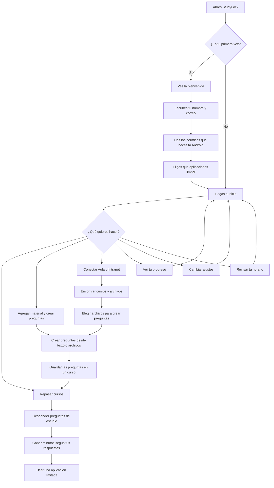
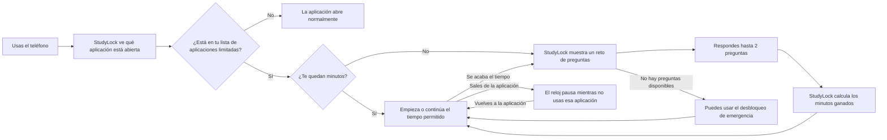
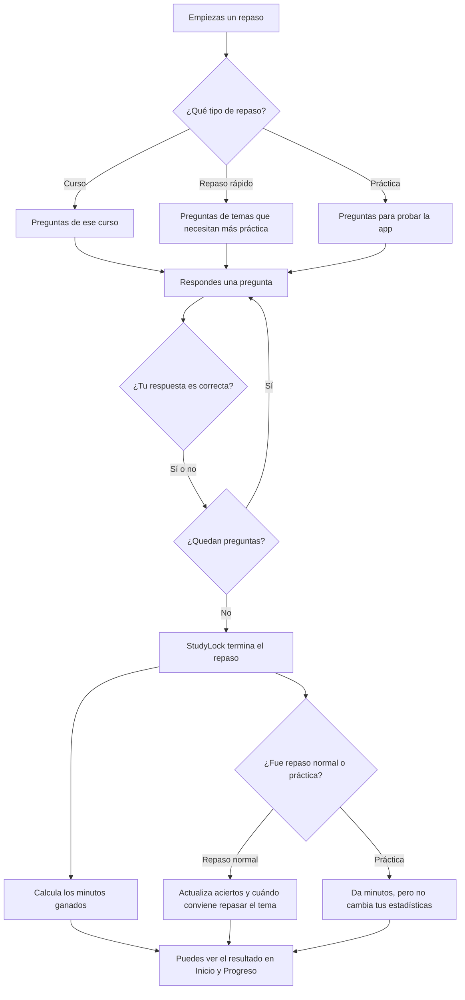
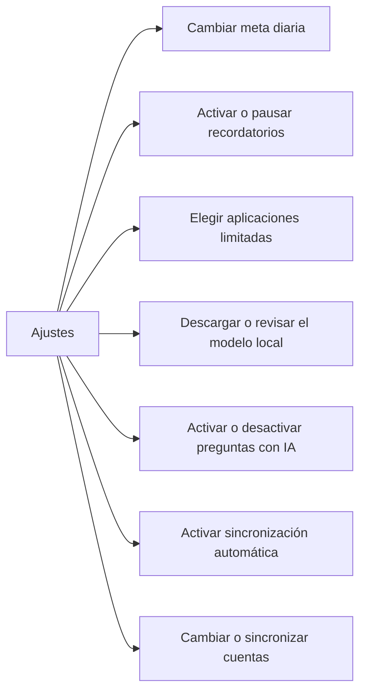
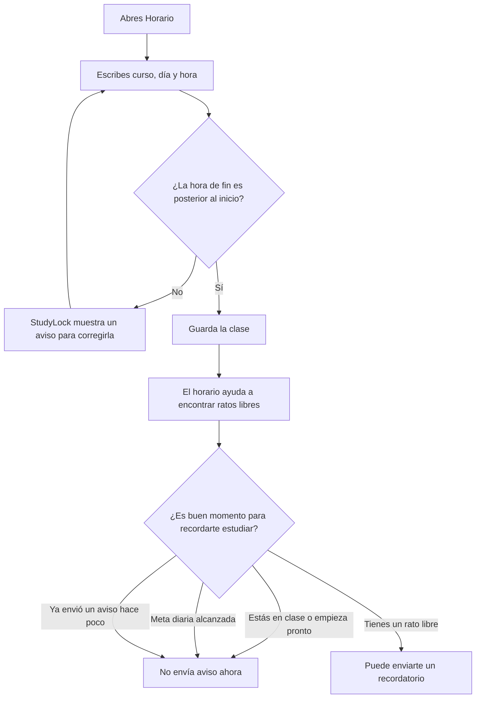
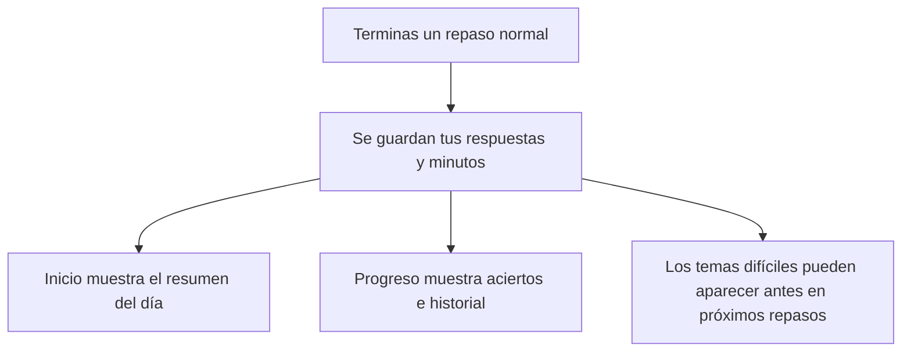
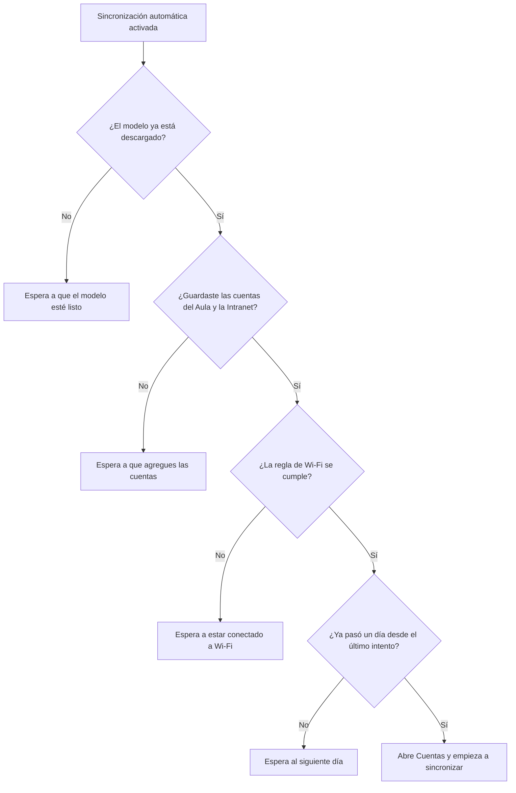
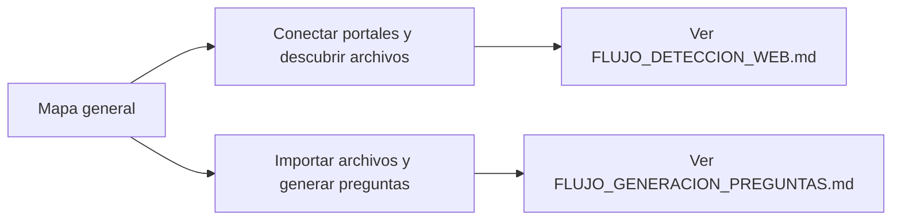

# StudyLock — mapa general

## ¿Qué puedes hacer en StudyLock?

## ¿Qué pasa cuando abres una app limitada?

## ¿Cómo ganas minutos al estudiar?

## ¿Qué puedes cambiar en Ajustes?

## ¿Cómo funciona el horario y cuándo llega un aviso?

## ¿Dónde ves tu avance?

## ¿Cuándo se sincronizan los cursos solos?

## ¿Qué explica cada guía?

