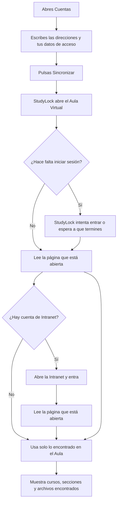
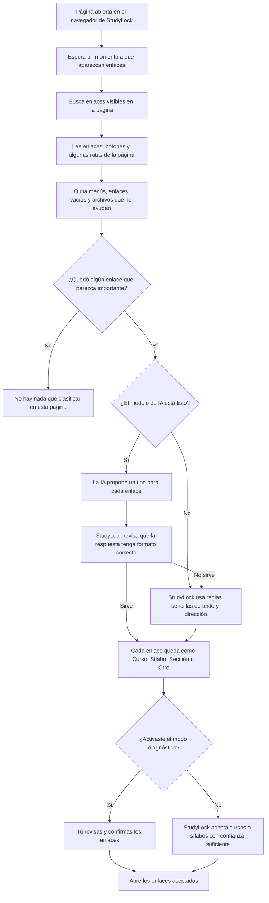
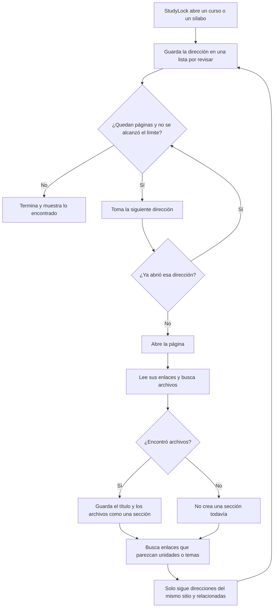
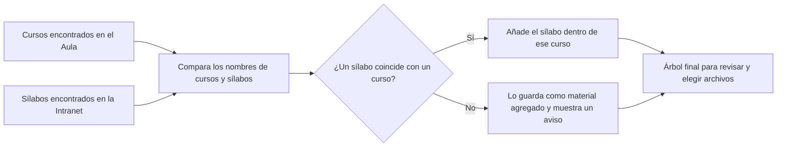
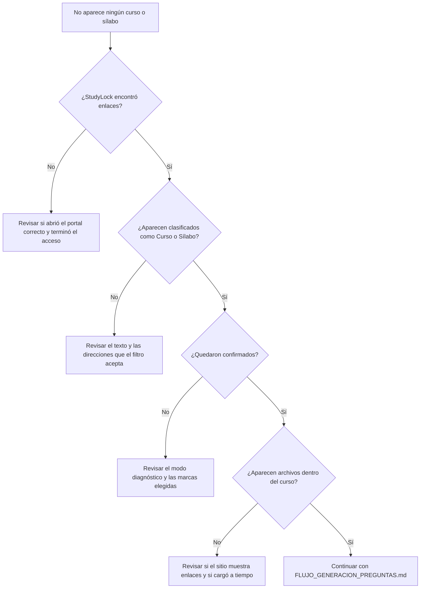

# Conectar Aula e Intranet

## ¿Cómo conectas tus cuentas?

## ¿Cómo decide qué enlace es un curso?

## ¿Cómo revisa las páginas de un curso?

## ¿Qué pasa con un sílabo encontrado?

## ¿Qué revisar si no aparecen cursos?

