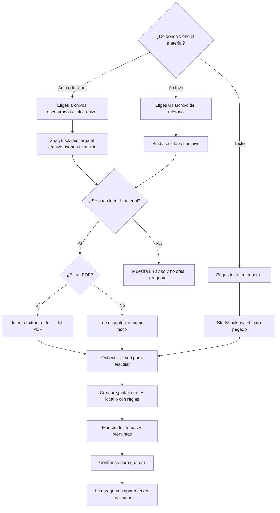
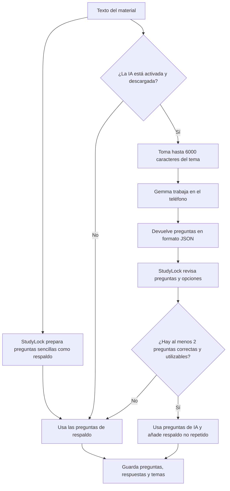
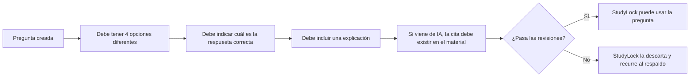
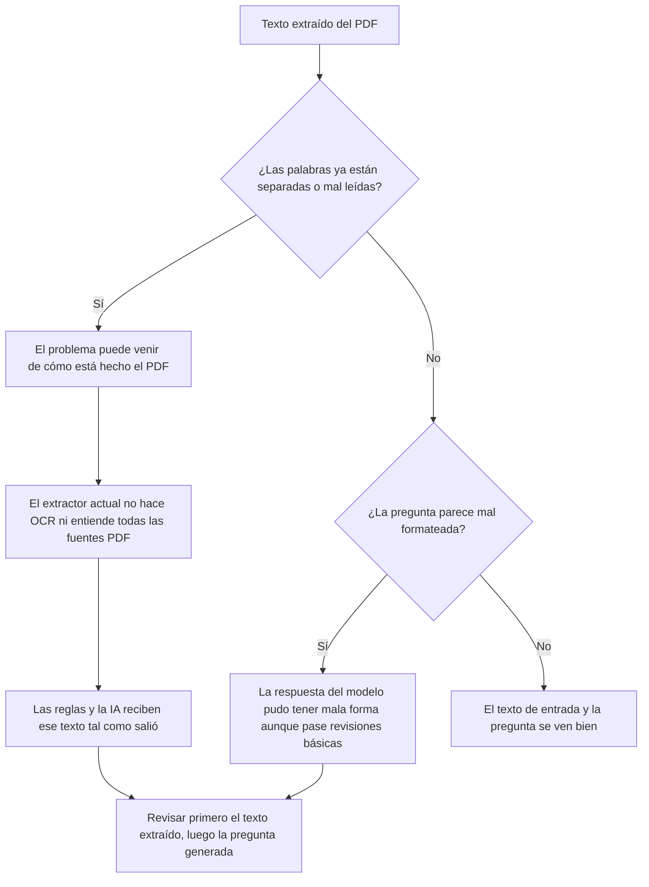
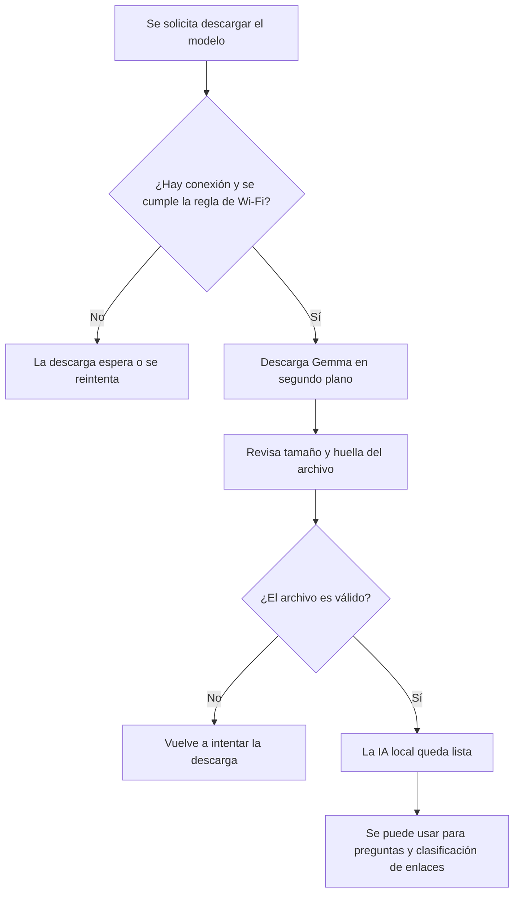

# Agregar material y crear preguntas

## ¿De dónde puedes traer material?

## ¿Cómo crea preguntas la IA?

## ¿Cómo revisa las preguntas?

## ¿Por qué el texto del PDF puede salir raro?

## ¿Cómo se descarga el modelo?

